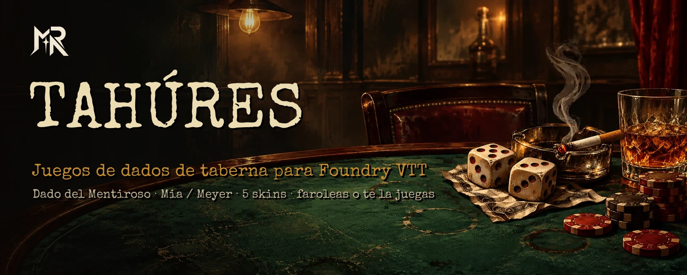
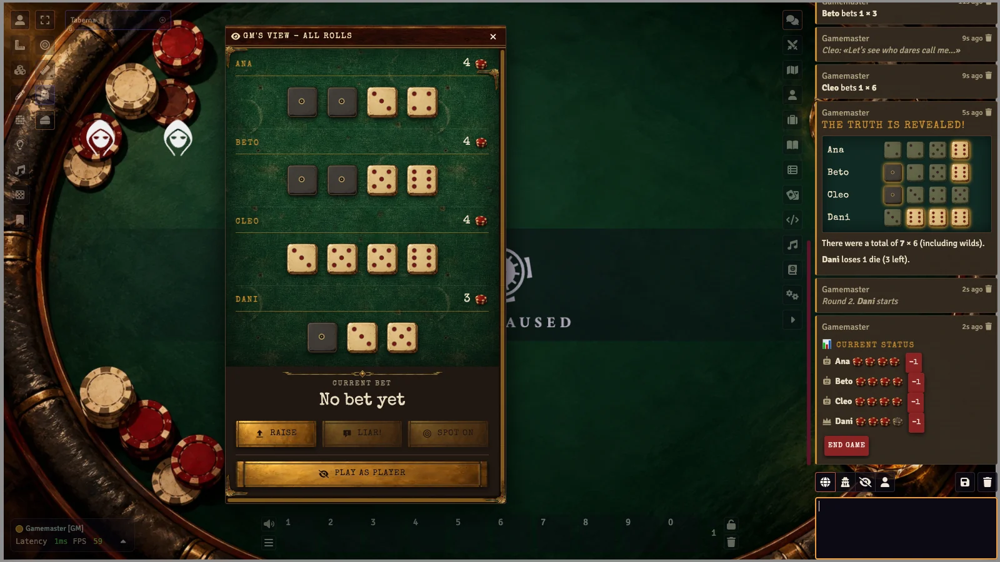
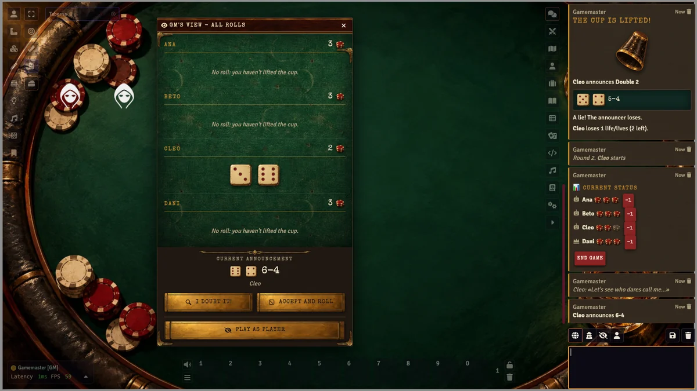
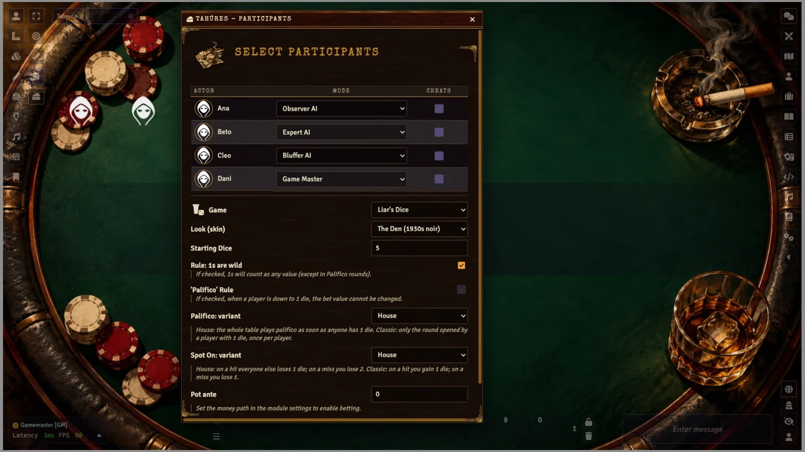
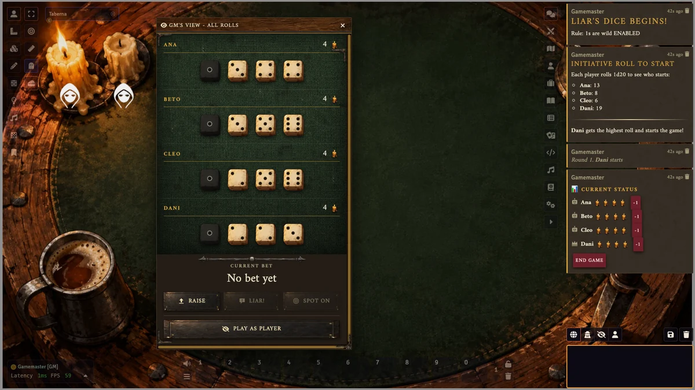
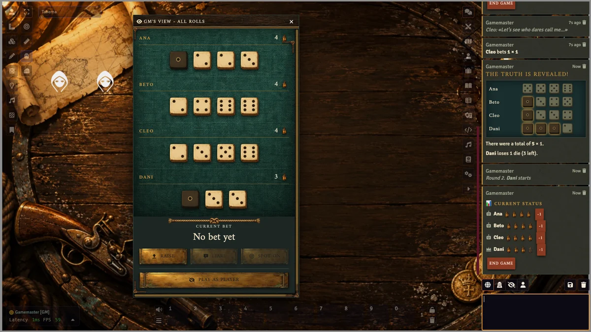
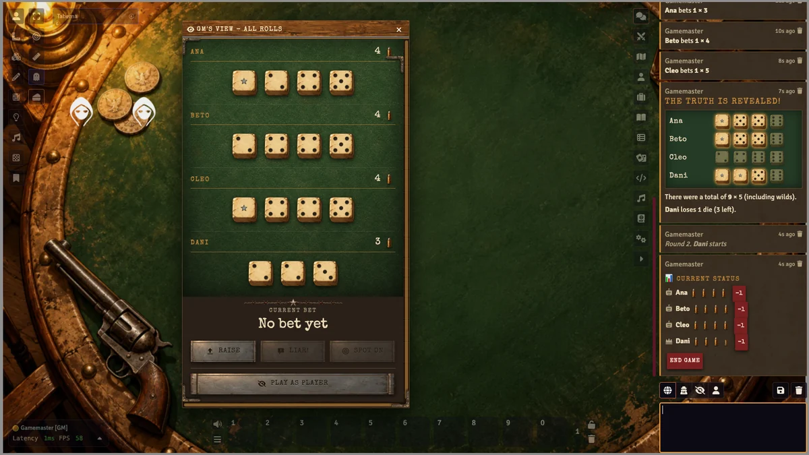
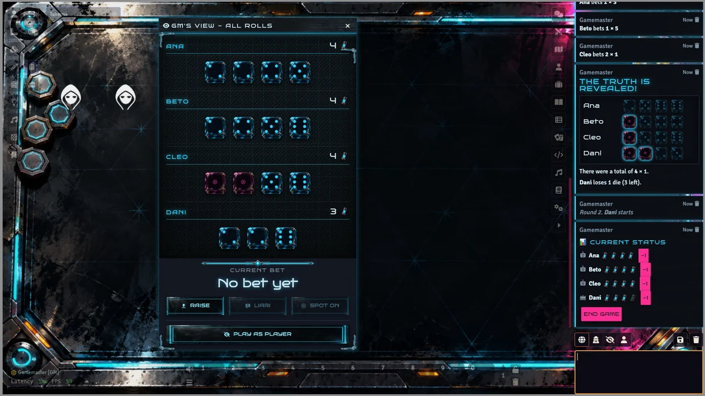

<p align="center">
  
</p>

<p align="center">
  <a href="https://github.com/ManuRomera/mr-queso-o-mentira/releases/latest"></a>
  
  <a href="https://github.com/ManuRomera/mr-queso-o-mentira/releases"></a>
  
  <a href="LICENSE"></a>
</p>

<h3 align="center">Faroleas, dudas y te juegas el bote.<br>Juegos de taberna para tu mesa de Foundry, vestidos de la ambientación que toque.</h3>

<p align="center"><sub>🇬🇧 <a href="#-english">Read in English</a></sub></p>

---

## ⚡ Instalación en 10 segundos

En Foundry: **Add-on Modules → Install Module → Manifest URL**, pega:

```
https://github.com/ManuRomera/mr-queso-o-mentira/releases/latest/download/module.json
```

Activa **MR- Queso o Mentira** en tu mundo y abre la mesa desde el botón del queso en los **Controles de token** (solo el Director de Juego). Las actualizaciones llegan desde el botón *Update* de Foundry.

<p align="center">
  
</p>

## 🎲 Qué juegos trae

### 🎲 Dado del Mentiroso (Perudo / Dudo)
Cada jugador tira sus dados a escondidas y se apuesta cuántos hay en toda la mesa. Sube la apuesta, **¡Mentira!** o **Calzar** (acertar justo). Los unos son comodín, hay **Palifico** y puedes elegir entre las reglas **de la casa** y las **clásicas** para calzar y palifico.

### 🥃 Mia / Meyer
Dos dados bajo el cubilete: anuncia lo que has sacado (¡o miente!) y supera siempre el anuncio anterior. Quien recibe el anuncio **cree y tira él**, o **duda** y se levanta el cubilete. La **Mia (2-1)** es lo más alto, no se puede superar y vale dos vidas.

<p align="center">
  
</p>

### 🗺️ En el plan
Diez Mil / Farkle · Capitán, Barco y Tripulación · Chuza (Craps) · Siete y media · Tabas · Pulso y concurso de bebida. Los emblemas ya están dibujados y el módulo tiene un **registro de juegos**: añadir uno es un motor de reglas, una vista y una línea de registro (guía en [`docs/JUEGOS.md`](docs/JUEGOS.md)).

## 🎭 Cinco ambientaciones (skins)

El mismo juego, vestido para cada mesa. Se elige en el propio formulario de partida o en los ajustes del módulo, y la ven todos.

| | |
|---|---|
| **🥃 El Garito** — trastienda noir de los años 30: tapete de fieltro, fichas de casino, humo y bourbon.<br> | **🕯️ La Taberna** — fantasía oscura: lana, hueso tallado, velas de sebo y una daga clavada en la mesa.<br> |
| **⚓ El Camarote** — piratas: lona salada, escrimshaw, doblones y un farol que se apaga.<br> | **🤠 El Saloon** — Oeste: pino, hueso polvoriento, balas por vidas y una estrella de latón.<br> |
| **🌃 La Cantina Neón** — ciberpunk: cristal ahumado, dados de resina y celdas de energía.<br> | **➕ Las tuyas** — una skin es un bloque de variables CSS y una carpeta de imágenes. |

## ✨ Lo que hace

- 🙈 **Manos privadas de verdad.** Los dados de cada jugador **no viajan en los datos públicos del mundo**: el GM los guarda en su cliente y cada dueño recibe **solo los suyos** por un mensaje dirigido. Si recargas la página, la mano vuelve sola.
- 🤖 **Seis IAs con personalidad:** básica, experta (calcula probabilidades), **tramposa** (conoce los dados), **farolera** (se tira faroles), **cauta** y **observadora** (recuerda quién miente más). Hablan en el chat con frases de taberna.
- 🕵️ **Jugadores tramposos:** el GM puede dar a un humano la vista de todas las manos.
- 💰 **Bote con dinero del actor.** Indica en los ajustes el campo numérico de tu sistema (por ejemplo `system.monedas.value`); cada jugador paga su entrada, el ganador se lleva el bote y, si cancelas, se devuelve. Los actores sin ese campo juegan por la casa.
- 🎬 **La revelación, en el chat:** todas las manos con los dados que cuentan resaltados, la copa levantada en Mia y las fichas de vida que se apagan.
- 🧑‍⚖️ **El GM manda:** juega como un jugador más o ve todas las manos, quita un dado desde el chat o termina la partida.
- 🛡️ **Seguridad en mesa:** solo el GM activo procesa las jugadas y cada acción se valida (¿es tu actor? ¿es tu turno?), así que nadie juega por otro ni fuera de turno.
- ⚙️ **Motor de reglas separado y con tests** (`npm test`), sin dependencias de Foundry.
- 🔌 Agnóstico de sistema. Sin dependencias. Español 🇪🇸 e inglés 🇬🇧.
- ♿ Texto alternativo en los dados, foco visible en todos los controles y colores con contraste en las cinco skins.

## 🕹️ Cómo se juega

1. **GM:** con los actores de la escena en tokens, pulsa el botón del queso (Controles de token).
2. Elige **juego**, **skin** y el **modo** de cada actor: Humano, Director de Juego (tú) o una de las IAs. Ajusta dados o vidas iniciales, reglas y la entrada del bote.
3. Se sortea quién empieza y cada humano recibe su **bandeja** con su mano; el GM ve todas.
4. En tu turno: **Subir / ¡Mentira! / Calzar** en el Dado del Mentiroso, o **Anunciar / ¡Dudo! / Acepto y tiro** en Mia.

## 🧰 API

```js
const api = game.modules.get("mr-queso-o-mentira").api;
api.GAMES;            // Map con los juegos registrados
api.registerGame(def); // registra un juego (ver docs/JUEGOS.md)
```

## 🤖 AI disclosure

Developed with AI-assisted coding and design support under the direction and review of Manuel Romera. Las imágenes de las skins se generaron con herramientas de IA para este módulo; los iconos son SVG propios. Detalles en [`NOTICE.md`](NOTICE.md).

## 📜 Licencia

MIT © 2026 Manuel Romera Chinchilla.

---

<a id="-english"></a>

## 🇬🇧 English

**MR- Queso o Mentira** brings tavern bluffing games to Foundry VTT, dressed in the setting your table needs. System agnostic, no dependencies, Foundry **v13**.

**Install:** *Add-on Modules → Install Module → Manifest URL*:

```
https://github.com/ManuRomera/mr-queso-o-mentira/releases/latest/download/module.json
```

### Games
- **Liar's Dice** (Perudo / Dudo): hidden hands, raise / call **Liar!** / **Spot On**, wild ones, Palifico, house or classic rules.
- **Mia / Meyer:** two dice under the cup, announce (or lie about) something higher; believe and roll, or doubt and lift the cup. Mia (2-1) beats everything and costs two lives.
- Coming: Farkle, Ship-Captain-Crew, Craps, Siete y media, Knucklebones, Arm-wrestle & drinking contest — the module has a game registry ([`docs/JUEGOS.md`](docs/JUEGOS.md)).

### Five skins
*The Den* (1930s noir), *The Tavern* (dark fantasy), *The Cabin* (pirates), *The Saloon* (Western) and *The Neon Cantina* (cyberpunk). Picked from the start form or the module settings, shared by the whole table.

### Highlights
- **Truly private hands:** dice never travel in the public world data; the GM keeps them client-side and each owner receives only their own via a targeted socket message. Reloading restores your hand.
- **Six AI personalities:** basic, expert, cheater, bluffer, cautious and observer (remembers who lies).
- **Pot with actor money:** set the numeric actor field in the settings (e.g. `system.coins.value`); entries are charged, the winner takes the pot, cancelling refunds. Actors without that field play for the house.
- **Reveal in chat** with every hand and the counting dice highlighted; GM can play as a player or see all hands.
- **Table safety:** only the active GM processes moves and every action is validated (your actor, your turn).
- Pure rules engine with tests (`npm test`). Spanish and English.

### AI disclosure & license
Developed with AI-assisted coding and design support under the direction and review of Manuel Romera. Skin artwork was generated with AI tools for this module; icons are hand-written SVG. MIT © 2026 Manuel Romera Chinchilla.

---

<p align="center">
  <a href="https://github.com/ManuRomera">
    <picture>
      <source media="(prefers-color-scheme: dark)" srcset="https://raw.githubusercontent.com/ManuRomera/ManuRomera/main/brand/MR_09_Monograma_Marfil_Transparente.png">
      
    </picture>
  </a><br>
  <sub>Hecho por <a href="https://github.com/ManuRomera"><b>Manu Romera</b></a> · Digital RPG Design</sub>
</p>
